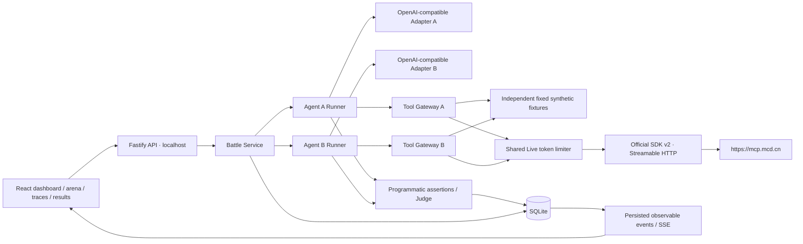

# Architecture

The React client observes a local Fastify API. The API records each event in SQLite before broadcasting it over SSE. Two Agent runs have separate model adapters, contexts, budgets and independent fixture failure counters. Only Live MCP calls share the client and token limiter.

`packages/shared` contains Zod schemas, errors, redaction and interfaces. `packages/mcp` owns official transport, fixtures and the gateway. `packages/runner` owns provider protocols and limits. `packages/benchmark` owns data assertions and weights. HTTP routing, job management and SQLite are separate modules in `apps/api`.

SQLite uses Node's built-in `node:sqlite` (Node >=22.13; currently emits an experimental warning). Logical tables are Battle, AgentRun, TraceEvent and JudgeResult. The normalized fields coexist with sanitized JSON payloads for full reports. A startup scan marks unfinished battles as interrupted without triggering new requests.

A battle is accepted with HTTP 202, then runs asynchronously on this machine. Up to two battles run concurrently; no distributed workers or recovery re-execution. Endpoints are bound to 127.0.0.1 and validate Host / Origin. Clients cannot supply arbitrary provider or MCP URLs. The browser never receives credentials.

Responses continuation uses response IDs within one isolated adapter. Reasoning text is neither requested nor recorded. The default model output cap is 2,000 tokens per request; scenario JSON controls total token budget, steps, tool attempts and overall deadline. Reported provider token usage includes input/output when supplied. When usage is absent, the runner conservatively counts the requested output allowance; upstream billing is outside this local accounting.

SSE sends durable IDs, replays persisted events after Last-Event-ID and sends heartbeats. The frontend merges event IDs and polls persisted state after interruptions. Reading a saved result never runs models again.
